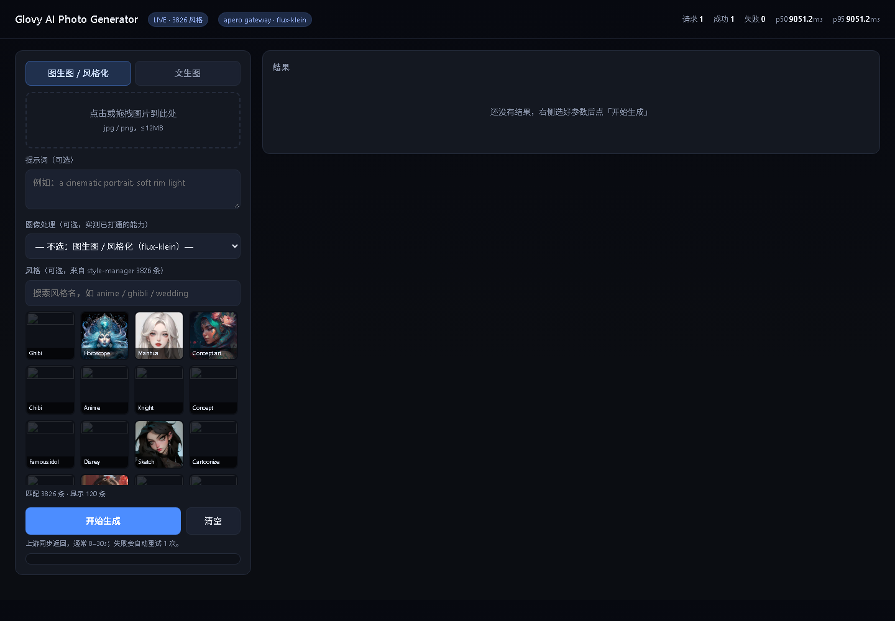
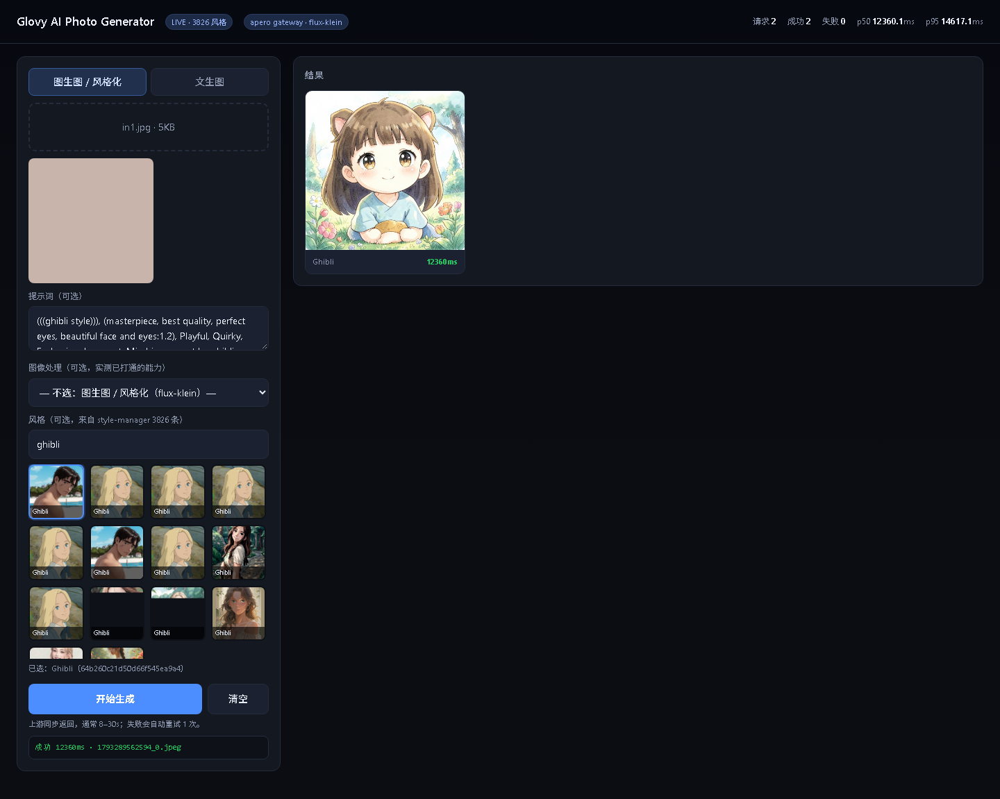
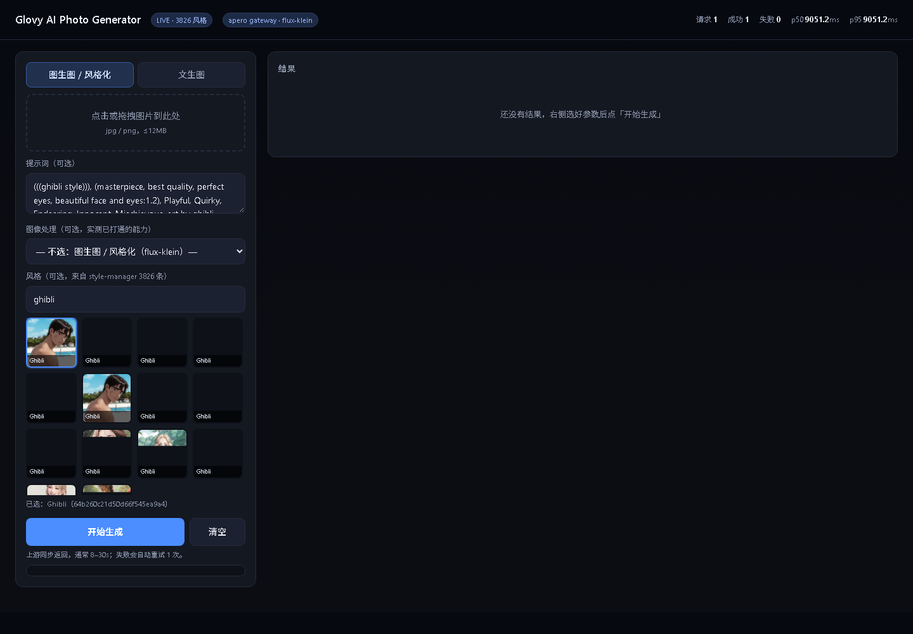
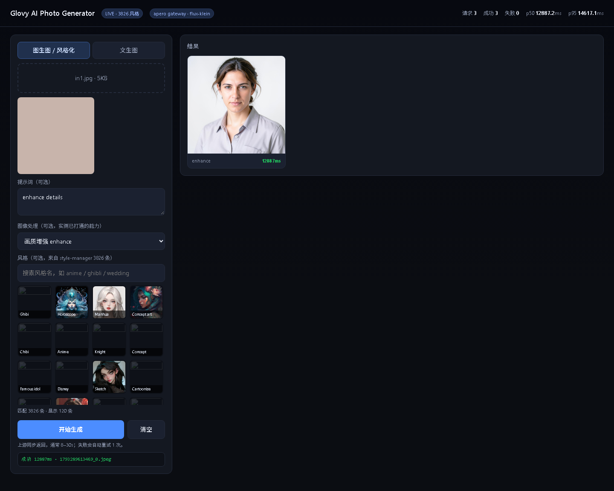

# Glovy AI Photo Generator → 2API（第一轮）

把 `Glovy – AI Photo Generator 1.9.0`（`com.aiphotogenerator.aivideomaker.photoslideshow`）的
Apero 系上游协议还原成本地 OpenAI 兼容网关。

- 逆向报告（端点全表 / 签名 / 凭据链 / 坑）：[`docs/REVERSE-REPORT.md`](docs/REVERSE-REPORT.md)
- new-api 对接指南：[`docs/NEW-API-INTEGRATION.md`](docs/NEW-API-INTEGRATION.md)

## 演示页截图

| 首屏 + 风格库 | 风格化出图 |
|---|---|
|  |  |

| 选风格 | 图像处理能力（enhance） |
|---|---|
|  |  |

## 效果样例

| 输入（真人照） | Ghibi 风格化输出 |
|---|---|
|  |  |

图生视频（`mode=i2v`）：h264 / 704×704 / 121 帧 / 5.04 s / 927 KB → `out_video.mp4`

## 能力（全部实测打通）

| 能力 | 端点 | 实测 |
|---|---|---|
| 文生图（含风格） | `POST /v1/images/generations` · `POST /api/v1/text2image` | ✅ 1024×1024，p50 6.4 s |
| 图生图 / 风格迁移 | `POST /v1/images/edits` · `POST /api/v1/generate` | ✅ 848×848，p50 8.0 s |
| 图生视频 | `POST /api/v1/video` | ✅ h264 704×704 / 121 帧 / 5.04 s，端到端 ~35 s |
| 画质增强 / 修复 / 扩图 / 抠背景 | `POST /api/v1/op/{name}` | ✅ enhance 9.1s、restore 14.0s、outpaint 8.9s、remove-bg 3.0s |
| 去物体 / 局部重绘（需蒙版） | 同上 | ✅ 16.2s / 12.0s |
| 自然语言编辑（qwen） | 同上 | ✅ 9.6s |
| 人像美颜 / AI 换装 / 服装试穿 | 同上 | ✅ 2.9s / 9.1s / 5.4s |
| 图像分割 | 同上 | ✅ 201（`data:[]`，需档位参数） |
| 风格库 | `GET /styles` | ✅ 3826 条 / 54 project |

`GET /api/v1/operations` 可列出全部 11 个能力与其必填输入。

## 快速开始

```powershell
pip install fastapi uvicorn requests cryptography

# 1) 填 key（三选一）
$env:APERO_API_KEY="sk-..."                     # 环境变量优先
# 或 cp config.example.json config.json 后填 api_key
# 或 python fetch_rc.py --app fravix            # 从 Firebase Remote Config 现取

# 2) 起服务（国内网络必须走代理）
$env:APERO_PROXY="http://127.0.0.1:10808"
$env:PORT="8956"
python server.py
# 浏览器打开 http://127.0.0.1:8956/
```

离线联调：`$env:APERO_MOCK="1"`（所有生成走 mock，不消耗上游）。

> `config.json` 不入库（`.gitignore`）；仓库只带 `config.example.json`。

## 文件

| 文件 | 作用 |
|---|---|
| `apero_client.py` | 协议封装：RSA 签名、时钟同步、presigned 上传、image-ai / text-2-image / image-2-video、风格库 |
| `server.py` | FastAPI 网关 + demo 页宿主 + 统计 |
| `demo.html` | 演示页：上传 / 风格选择（缩略图 + 搜索）/ 生成 / 结果墙 / 实时 p50-p95 |
| `bench.py` | 压测（`--mode mock|real`，real 上限 30 次保护上游） |
| `verify_demo.py` | Playwright 真实浏览器 e2e（首屏→风格→上传→出图→统计） |
| `probe_siblings.py` | 兄弟端点批量实测脚本（产出 `probe_siblings.json` 证据） |
| `fetch_styles.py` | 重建 `styles_v3.json`（3826 条） |
| `fetch_rc.py` | 从 Firebase Remote Config 拉 `api_key`（含 Glovy/Fravix 预置参数） |
| `config.example.json` | 凭据模板（真实 `config.json` 不入库） |
| `styles_v3.json` | 风格目录 |

## 实测

```
mock   300 req / 30 并发 → 100% ok, 326 rps, p50 88.9 ms
real   文生图  8 req / 2 并发 → 8/8 ok, p50 6.4 s, p95 8.6 s
real   图生图  6 req / 2 并发 → 6/6 ok, p50 8.0 s, p95 14.3 s
real   图生视频 1 次 → completed, 704×704 h264 5.04s 927KB
real   兄弟端点 11 项 → 全部 201（见 docs/REVERSE-REPORT.md §4.5）
e2e    浏览器路径 PASS（Ghibli 风格 848px 出图）
```

## 关键坑（详细见报告）

1. 八个请求头缺一即 412；签名 `RSA_PKCS1(f"{ts}@@@{api_key}@@@{rand}")` **不覆盖请求体**。
2. `x-api-token`（Play Integrity）与 `bundleId` **不是硬校验**，`not_get_api_token` 即可。
3. Glovy 自己的 `api_key` 已被上游停用（401 `Not active api key`）；key 与 bundleId 不绑定，用同厂在运营 App 的 RC `app_api_key` 即可。
4. `styleId` 必须是 style-manager 的 24 位 ObjectId，**不是** RC 里的数字 `style_id`。
5. 上传（S3 PUT）**不要带签名头**；**presigned 只有 wrapper 有路由**，`core-outpaint`/`image-restore-core` 上的 presigned 全 404。
6. **视频 `mode` 必须是小写 `"i2v"`**（不是枚举 `IMAGE_TO_VIDEO`），且 `notificationProvider`+`notificationId` 必填；成品在 `data.result.resultFile`。
7. `fitting` 用 `inputImage/clothImage/clothType(upper_body|lower_body|full_body)`；`remove-object` 的 `mask` 必须是另一次上传的 path；`inpainting` 必须 multipart。
8. 结果 CDN `static.aperogroup.ai` 在部分网络需走网关 `/media` 代理。

## 合规与风险

上游是第三方在运营服务，本网关不伪造内购/广告，只转发协议。**key 借用同厂 App 的客户端凭据，可能被风控封禁**；
上游 `/health` 显示 wrapper 并发上限 20，请勿高强度压测，建议网关侧并发 ≤ 4。
